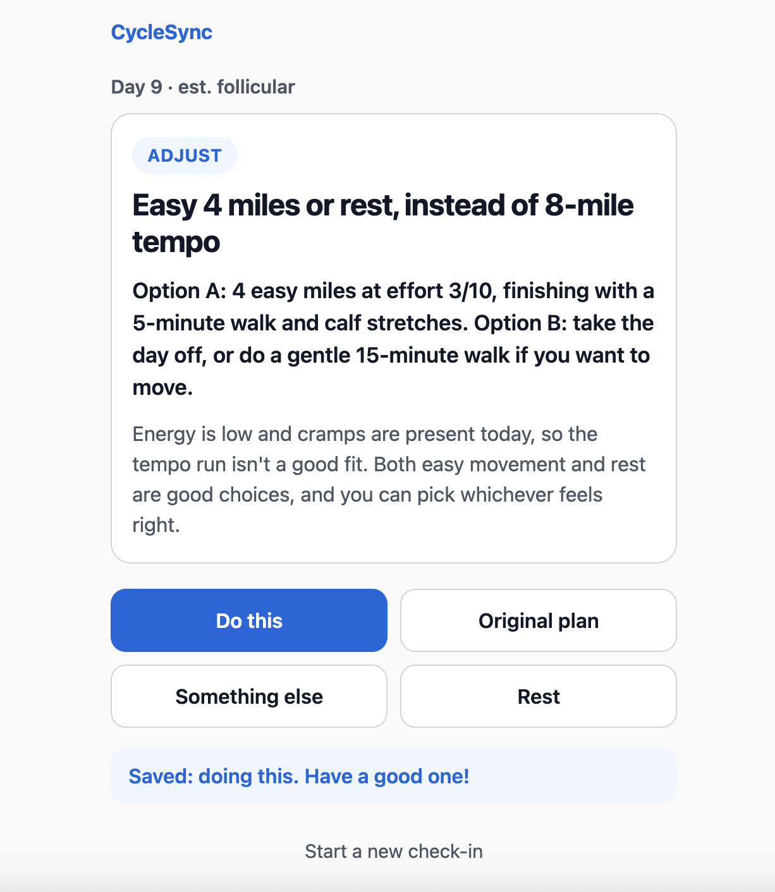

# CycleSync

**A women's health AI coach.** A 20-second morning check-in that tells active women whether to keep, adjust, swap, or rest today's planned workout, based on how they actually feel and where they are in their cycle.

**Status:** In progress, launching December 2026. · [Live app](https://jjs10216-cyclesync.vercel.app) (invite-only for testers) · [Product Page](https://building-with-ai-f26.github.io/jjs10216-cyclesync/)



## Why

Should women train by cycle phase? The research says no: phase effects on performance are small and inconsistent, and the main reviews recommend personalizing to each woman's own response. So CycleSync puts **how she feels first** (energy, sleep, symptoms, soreness). Cycle day and estimated phase are **context only**, and the app never claims a phase makes her stronger or weaker. Sources and strength of evidence: [research/evidence-brief.md](research/evidence-brief.md).

## How it works

Tap-only check-in → safety rules in code → cycle day + estimated phase → AI recommendation → checks in code (one retry, then a rule-based fallback) → card → her response saved with the check-in.

## Safety approach

- **Medical-safety rules run in code before any AI call.** Warning signs (for example, soaking a pad every hour, or cramps that are worse than usual) get a fixed message to check in with a doctor, with no workout advice. Tests confirm the AI is never called in these cases.
- **Every AI answer is checked in code** before she sees it. The checks catch:
  - a verdict other than the four allowed;
  - a prescription without numbers;
  - a workout longer or harder than planned;
  - phase-performance claims, diet or calorie advice, and fertility talk;
  - pushing hard on a cramp day.

  A failed answer is retried once, with the AI told which rules it broke. If it fails again, a rule-based coach answers instead.
- **Privacy:**
  - **Invite-only:** each tester gets a personal invite link. Codes are stored only as hashes, and one invite can't reach another tester's data.
  - **Analytics:** health answers and the recommendation card are hidden in PostHog session replays and never sent as event data.
  - **Database:** Supabase Postgres with Row Level Security on every table and no access for the public key. Only the server, holding a key that lives only in Vercel's settings, can read or write data.
  - **AI spending:** limited by a rate limit on AI check-ins.

  Security audit (in progress): [SECURITY.md](SECURITY.md).

## How it was built

I'm a product manager: 5 years at CVS Health, now an NYU Stern Tech MBA. I did the research, the recommendation spec, the safety rules, the testing and the product decisions, and directed Claude Code as my engineering team. It works from three files:
- [AGENTS.md](AGENTS.md): ground rules and commands;
- [Plan.md](Plan.md): the build plans;
- [research/recommendation-spec.md](research/recommendation-spec.md): exactly how a check-in becomes a recommendation.

## Tech stack

| Part | What |
| --- | --- |
| **Frontend** | Plain HTML, CSS and JavaScript; no framework, no build step. Works in a phone browser. |
| **Backend** | Node.js serverless functions on Vercel (`api/`), with **zero npm packages**. |
| **Database** | Supabase Postgres (live, Row Level Security on every table); a local JSON file for development. |
| **AI** | Claude Haiku 5.5 through OpenRouter, with structured JSON output. **About $0.0004 per check-in** (measured average of 16 real check-ins: $0.0002–$0.0008). Safety-screen check-ins cost $0. |
| **Analytics** | PostHog: funnel events and session replay, with health data masked. |
| **Testing** | 230 unit tests (Node's built-in test runner); a headless-Chrome check that clicks through every screen at phone size; a database lock test using the public key; live-site security checks. |

## Run it locally

You need Node.js 22 or newer (tested on Node 26). There's nothing to install, and with no keys the app uses a free mock AI coach.

```bash
git clone https://github.com/building-with-ai-f26/jjs10216-cyclesync.git
cd jjs10216-cyclesync
cp .env.example .env              # works as is: no keys = free mock AI coach
npm test                          # 230 tests, no browser, no cost
npm run invite -- --local dev     # makes a local invite and prints your link
npm run dev                       # then open the link it printed
```

The app is invite-only, so open the printed `http://localhost:3000/?code=...` link, not the bare address. To use the real AI, add `OPENROUTER_API_KEY` to `.env`. `npm run test:browser` runs the click-through check; it needs Google Chrome.

## Course context

Built in NYU Stern's **Building with AI** course (TECH-GB 2160, Fall 2026).
- **Builder:** Julia Simon (`juliasimon16`)
- **Pod:** 3
- **Links:** [Product Page](https://building-with-ai-f26.github.io/jjs10216-cyclesync/) · [AGENTS.md](AGENTS.md) · [Plan.md](Plan.md) · [SPONSOR_MEMO.md](SPONSOR_MEMO.md) · [journal/](journal/)
